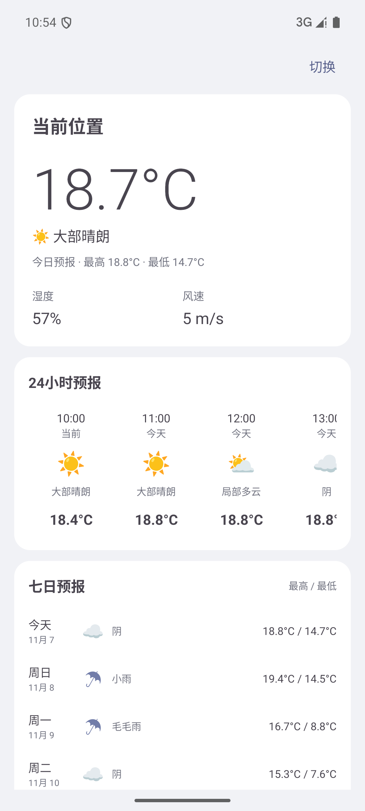
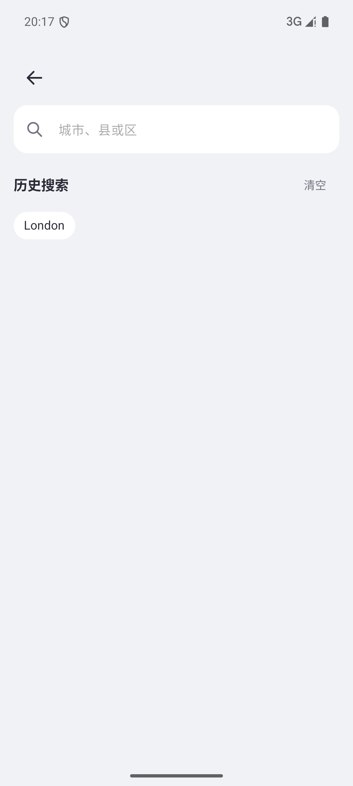
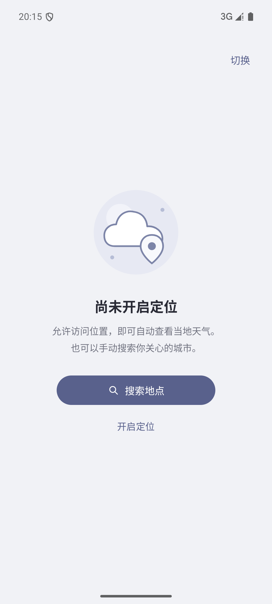
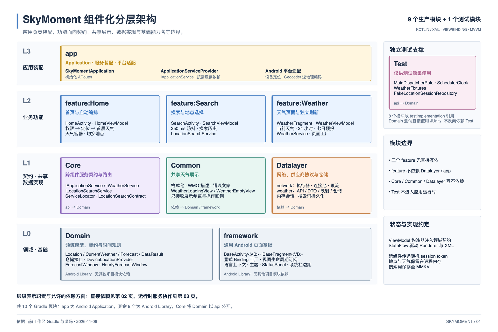
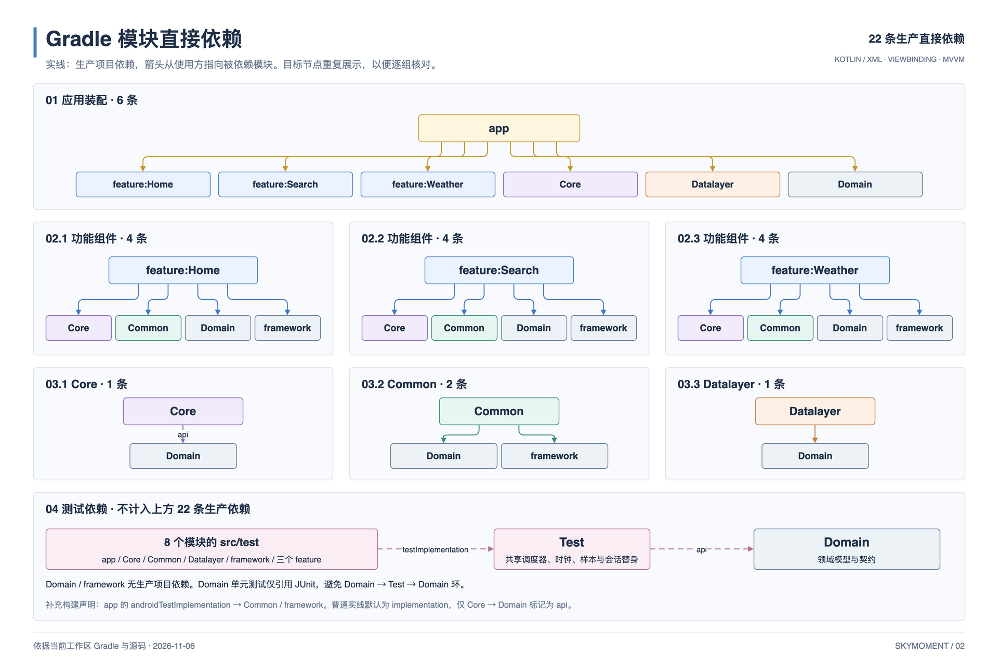
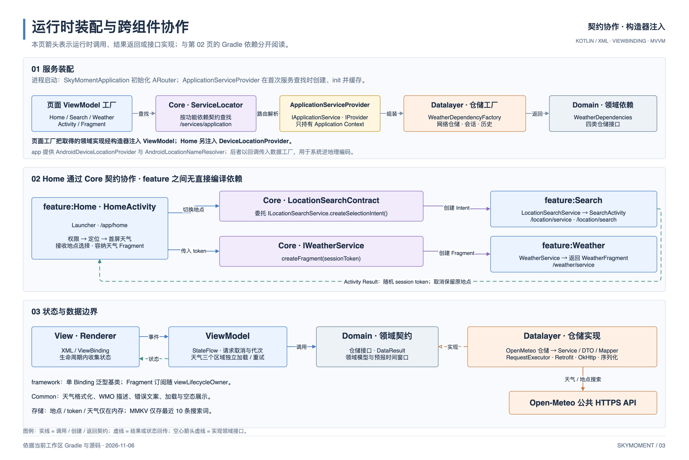

# SkyMoment

一款无需登录的 Android 天气应用，提供当前位置天气、全球地点搜索、24 小时预报和七日预报。

[下载 APK](#下载安装) · [功能与界面](#功能与界面) · [项目架构](#项目架构) · [源码运行](#源码运行) · [开发与验证](#开发与验证) · [项目文档](#项目文档)

## 下载安装

**[下载 SkyMoment 1.0 Debug APK](docs/downloads/skymoment-1.0-debug.apk?raw=true)** · [SHA-256 校验文件](docs/downloads/skymoment-1.0-debug.apk.sha256)

| 项目 | 安装包信息                    |
| --- |--------------------------|
| 版本 | `1.0`（versionCode `1`）   |
| 构建日期 | 2026-11-06               |
| 类型 | Debug，使用调试签名             |
| 大小 | 21.2 MiB（22,186,287 字节）  |
| 应用 ID | `com.example.skymoment`  |
| 系统要求 | Android 7.0 / API 24 及以上 |

在 Android 设备上下载并打开 APK，按系统提示允许当前浏览器或文件管理器安装应用。安装后可授权前台定位查看当地天气，也可使用首页右上角的“切换”搜索其他地点。

已克隆仓库、连接设备并启用 USB 调试时，可从项目根目录安装附件：

```bash
adb install -r docs/downloads/skymoment-1.0-debug.apk
```

<details>
<summary>校验安装包完整性</summary>

macOS / Linux 下，从项目根目录执行：

```bash
cd docs/downloads
shasum -a 256 -c skymoment-1.0-debug.apk.sha256
```

预期输出 `skymoment-1.0-debug.apk: OK`。校验文件与 APK 一同维护；更新附件时应重新生成校验值。

</details>

该附件是上述日期的 Debug 体验包，已完成构建和 APK 签名校验；后续源码更新不会自动替换此文件。需要运行最新源码时，请按[源码运行](#源码运行)重新构建。

## 功能与界面

| 功能 | 当前行为 |
| --- | --- |
| 当前位置天气 | 支持近似定位，展示温度、天气概况、湿度与风速，异步补充地点名称 |
| 全球地点搜索 | 支持城市、县区和海外地点；中文行政后缀与拼音补查，候选展示行政路径 |
| 24 小时与七日预报 | 按地点时区展示逐小时天气、每日概况及最高 / 最低温 |
| 地点切换与历史 | 独立搜索页选择后更新原首页，取消保留原地点；保存最近 10 条搜索词 |
| 加载与恢复 | 当前天气、小时和七日预报独立加载、重试；刷新失败保留已有内容 |
| 多语言 | 跟随系统首选语言，支持简体中文、繁体中文和英文，其他语言回退英文 |

温度、风速、湿度单位固定为 `°C`、`m/s`、`%`。天气按前台恢复时效、地点整点和跨日规则自动更新。

| 天气首页 | 地点搜索 | 定位引导 |
| :---: | :---: | :---: |
| <a href="docs/screenshots/weather-current.png"></a> |  |  |

天气首页截图摄于 **2026-11-07**：应用启动后自动获取模拟器位置，展示 Open-Meteo 返回的真实天气数据，包括当前温度、天气概况、湿度、风速、24 小时预报与七日预报。点击截图可查看原图；截图中的位置由模拟器提供。

地点搜索与定位引导为历史模拟器截图。当前版本统一通过首页右上角“切换”打开搜索，空态内不再重复提供搜索按钮。

## 项目架构

工程包含 **9 个生产模块、22 条生产项目直接依赖**，以及独立的共享测试模块 `Test`。`app` 负责装配，三个 feature 通过 `Core` 的服务契约协作；ViewModel 通过构造器接收 `Domain` 契约，使用 Coroutines / StateFlow 管理状态。

### 分层职责

[](docs/diagrams/skymoment-architecture-overview.png)

### 模块依赖与运行时协作

<details>
<summary>查看 Gradle 直接依赖图</summary>

[](docs/diagrams/skymoment-module-dependencies.png)

实线表示生产编译依赖，方向为使用方 → 被依赖模块。重复展示的目标节点表示同一模块；测试依赖单独标注。

</details>

<details>
<summary>查看运行时装配与数据流</summary>

[](docs/diagrams/skymoment-runtime-collaboration.png)

ARouter 按需解析 `AppServices`；Home 通过搜索结果契约接收随机 session token，通过天气服务创建 Fragment。地点和天气由进程内共享仓储保存。

</details>

三张图片来自同一份 **[可编辑 draw.io 架构图](docs/diagrams/skymoment-layered-architecture.drawio)**，对应文件内的三页；点击图片可查看原图。

| 模块 | 职责 |
| --- | --- |
| [`app`](app) | Application、服务装配、Android 系统定位与逆地理编码 |
| [`feature:Home`](feature/Home) | 首页启动、权限交互、天气容器和地点切换 |
| [`feature:Search`](feature/Search) | 地点搜索、关键词历史和选择结果服务 |
| [`feature:Weather`](feature/Weather) | 天气 Fragment、当前 / 小时 / 七日状态及页面工厂 |
| [`Core`](Core) | 页面与服务路由、传参约定、跨组件服务契约及查找 |
| [`Common`](Common) | 天气格式化、WMO 描述、错误文案、加载与空态视图 |
| [`Datalayer`](Datalayer) | 网络执行器、Open-Meteo API / DTO / 映射、仓储与存储 |
| [`Domain`](Domain) | 领域模型、仓储 / 定位接口和预报时间窗口规则 |
| [`framework`](framework) | 页面基类、Binding 生命周期、语言上下文、主题与通用状态组件 |
| [`Test`](Test) | 测试调度规则、虚拟时钟、领域样本与会话替身 |

`app` 为 Android Application，其余模块均为 Android Library。三个 feature 不直接互依，也不依赖 `app` 或 `Datalayer`。`Test` 只由测试源集引用，不进入应用运行时；`Domain` 的测试直接使用 JUnit，避免依赖环。

页面采用显式 Binding 工厂，Fragment 订阅跟随视图生命周期。网络实现使用 Retrofit、OkHttp 与 kotlinx.serialization，中文拼音补查使用 ICU4J。详细设计见[工程架构](docs/architecture.md)和[测试指南](docs/testing.md)。

## 源码运行

### 环境要求

| 项目 | 当前配置 |
| --- | --- |
| JDK / Gradle daemon | 21 |
| Gradle Wrapper | 9.5.0，已包含在仓库中 |
| Android Gradle Plugin | 9.3.3 |
| Android SDK | `compileSdk 37` / `targetSdk 36` / `minSdk 24` |
| Java 编译目标 | 11 |
| Android Studio | 使用兼容上述 AGP 与 SDK 的版本 |

SDK、插件和依赖版本统一维护在[版本目录](gradle/libs.versions.toml)，Gradle 与 daemon JVM 配置见 [Wrapper](gradle/wrapper/gradle-wrapper.properties) 和 [JVM 配置](gradle/gradle-daemon-jvm.properties)。

### 构建与安装

1. 克隆项目：

   ```bash
   git clone https://github.com/duxgwork/SkyMoment.git
   cd SkyMoment
   ```

2. 用 Android Studio 打开项目，安装 Android SDK Platform 37 并同步 Gradle。命令行构建可设置 `ANDROID_HOME`，或在根目录的 `local.properties` 中填写本机 SDK 路径：

   ```properties
   sdk.dir=/absolute/path/to/Android/Sdk
   ```

3. 构建 Debug APK：

   ```bash
   ./gradlew :app:assembleDebug
   ```

   输出为 `app/build/outputs/apk/debug/app-debug.apk`。该目录被 Git 忽略，与 README 附带的 `docs/downloads/` 安装包分开维护。

4. 连接 Android 7.0 及以上设备或启动模拟器，在 Android Studio 中运行 `app`，或执行：

   ```bash
   ./gradlew :app:installDebug
   ```

Windows 下将 `./gradlew` 替换为 `gradlew.bat`（PowerShell 使用 `.\gradlew.bat`）。首次构建需要下载依赖；天气和地点搜索需要网络连接。项目不需要配置天气服务密钥。

## 开发与验证

在项目根目录执行：

```bash
# 全部模块的本地单元测试，无需设备
./gradlew testDebugUnitTest

# 静态分析与 Debug / Release 构建
./gradlew lint :app:assembleDebug :app:assembleRelease
```

业务规则使用 JUnit 与协程测试工具；Android API、资源和页面基础行为使用 Robolectric；网络层使用本地 MockWebServer。覆盖范围和单模块执行方式见[测试指南](docs/testing.md)。

<details>
<summary>在设备上验证压缩后的路由与页面装配</summary>

连接设备后执行项目保留的 Release 路由冒烟测试：

```bash
./gradlew :app:connectedReleaseAndroidTest \
  -PtestBuildType=release \
  -PlocalSmokeSigning=true \
  -ProuteSmoke=true
```

该测试检查 ARouter、服务装配与天气 Fragment，使用独立的 `RouteSmokeInstrumentation` 和测试数据源集。`localSmokeSigning=true` 仅为本机验证启用 Debug 签名；普通 Release 构建启用 R8，未配置发布签名。分发体验包请使用普通 `:app:assembleDebug` 构建。

</details>

上述命令是验证入口，不代表全部设备和环境均已通过。历史结果见[工程验证记录](docs/build-validation.md)；本机代理配置导致的构建问题也在该文档中记录。

## 项目文档

| 文档 | 内容 |
| --- | --- |
| [可编辑架构图](docs/diagrams/skymoment-layered-architecture.drawio) | 分层职责、Gradle 依赖、运行时装配三页图 |
| [工程架构](docs/architecture.md) | 模块边界、服务协作、状态归属与生命周期 |
| [测试指南](docs/testing.md) | Test 模块、单元测试覆盖矩阵和执行方式 |
| [数据契约](docs/data-contract.md) | 模型、单位、时区与数据处理规则 |
| [页面验证](docs/page-validation.md) | 页面状态、交互流程与测试映射 |
| [界面方向](docs/ui-direction.md) | 布局、视觉与组件约定 |
| [工程验证记录](docs/build-validation.md) | 构建、测试与设备验证的历史证据 |
| [Open-Meteo 验证记录](docs/open-meteo-validation.md) | 公共端点、代表地点与待验证项 |
| [OpenSpec 实施任务](openspec/changes/add-global-weather-app/tasks.md) | 功能实施与验收进度 |

## 权限、存储与使用边界

- **定位**：仅申请前台近似 / 精确位置，不申请后台定位；拒绝权限后可从空态打开设置，或通过“切换”手动选择地点。
- **传输**：天气查询向 Open-Meteo 发送坐标，地点搜索发送关键词；当前位置名称通过 Android 系统逆地理编码解析。供应商的数据处理说明见 [Open-Meteo 隐私政策](https://open-meteo.com/en/terms#privacy)。
- **存储**：SharedPreferences 仅保存最近 10 条搜索词，支持清空。地点对象、坐标和天气仅保留在进程内存，应用关闭系统备份。
- **恢复**：断网或刷新失败时保留已有内存数据；进程结束后不恢复旧地点与天气，下次启动重新尝试定位。
- **覆盖**：地点搜索取决于地名数据覆盖，同名地点需根据行政路径选择。真实午夜、不同区域网络和完整 Android 设备矩阵仍有待验证项，见 [Open-Meteo 验证记录](docs/open-meteo-validation.md)。

## 数据来源与许可

天气数据来自 [Open-Meteo](https://open-meteo.com/)，其数据采用 CC BY 4.0；当前使用的免费公共 API 限非商业用途，并受请求限额约束。具体要求以供应商[使用条款](https://open-meteo.com/en/terms)为准。

地点搜索使用 [Open-Meteo Geocoding API](https://open-meteo.com/en/docs/geocoding-api)，地名数据来自 GeoNames。天气数据与地名数据的许可不代表本项目源代码的许可；仓库当前尚未包含 `LICENSE` 文件。

## 参与贡献

欢迎提交 [Issue](https://github.com/duxgwork/SkyMoment/issues) 或 Pull Request。报告问题时请提供复现步骤、预期与实际表现、设备型号、Android 版本及系统语言；搜索或天气问题可补充查询词和所选地点的行政路径。

提交前运行相关单元测试和 lint。调整模块边界时同步更新架构文档、draw.io 源图及三张预览；更新安装包时同步维护 APK、SHA-256 和版本信息。界面文案维护简体中文、繁体中文和英文资源，涉及页面交互时补充设备验证。
