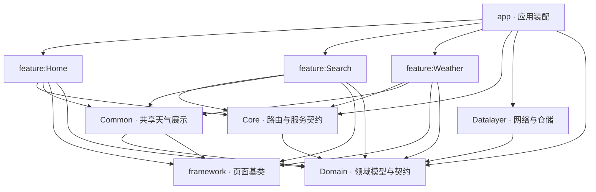
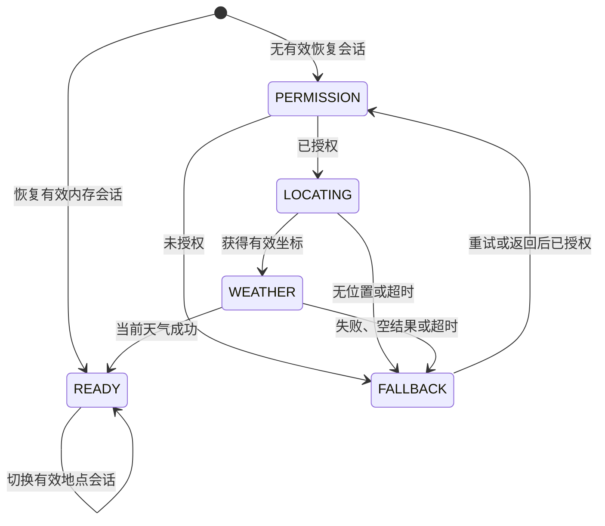

# 工程架构

## 当前交付边界

工程已接入无凭据的 Open-Meteo 公共端点、搜索与天气 XML 页面。当前天气、24 小时预报和七日预报分别请求，领域模型保留数值与 WMO 代码，界面本地翻译。外部区域网络与真实午夜等验收门槛仍按 OpenSpec 追踪；实现完成不代表这些门槛已通过。

## 六个设计关注点

| 方面 | 实现与设计取舍 | 对应验证 |
| --- | --- | --- |
| 应用架构与元件设计（Application Architecture / Component Design） | 单向模块依赖；app 装配实现，feature 面向 Domain 和 Core 契约。通用能力与天气专用展示分别在 framework 与 Common，业务组件通过服务契约协作。 | 架构边界脚本、服务单例及混淆包路由测试。 |
| 状态管理（State Management） | ViewModel 持有业务状态，View 收集只读 StateFlow。请求代次与取消共同阻止旧结果覆盖新选择；三个天气区域独立更新，失败保留已有内容。 | HomeViewModelTest、SearchViewModelTest、WeatherViewModelTest；旋转与前后台设备测试。 |
| API 集成（API Integration） | DTO／供应商协议与通用 HTTP 分别位于 Datalayer.weather 和 Datalayer.network。工厂共享连接池与限流门；接口、时钟、查询调度器可替换。 | HTTPS MockWebServer、序列化、请求参数、取消、截止时间及 429 配额测试。 |
| 程式码组织（Code Organization） | 以职责划分模块，功能代码按搜索／天气归组；Core 不放业务状态或业务错误文案。路由、服务地址、传参键分开，平台定位留在 app。 | Gradle 依赖、生产源码引用与模块清单一致性检查。 |
| 错误处理（Error Handling） | 网络失败、领域失败与用户文案逐层转换；区分空结果、首次失败、刷新失败与局部失败。协程取消继续传播，避免把取消显示成故障。 | 错误分类、缺失数据、局部重试、旧数据保留和空态恢复测试。 |
| 可维护性（Maintainability） | 核心规则使用构造器注入、共享请求管理和集中版本目录；测试使用 Fake、可控时间及生命周期同步；边界脚本拦截逆向依赖和环。 | 单元测试、lint、Debug UI 回归、R8 冒烟；实际结果记录在验证文档。 |

## 模块与依赖

2026-11-06 架构重构参照 OSL Global Android 的 `Core / Common / Datalayer / feature` 命名，以及其本地 `osl-android-design/framework` 的单 Binding 泛型基类。保留当前 ViewBinding、ARouter、构造器注入和领域层职责，Domain 配置为 Android Library；不引入参考项目的 Flutter、交易服务、DataBinding 或事件总线。

| 模块 | 职责 |
| --- | --- |
| `app` | Application、ARouter 服务实现与依赖组装、系统定位及逆地理编码 |
| `feature:Home` | 首页启动、权限交互、天气容器和地点切换 |
| `feature:Search` | 地点搜索、搜索历史和选择结果服务 |
| `feature:Weather` | 天气 Fragment、小时及七日预报、天气页面工厂服务 |
| `Core` | 路由、传参约定、跨组件 `I*Service` 契约与服务查找 |
| `Common` | 天气格式化、WMO 描述、错误文案、加载与空态视图 |
| `Datalayer` | 通用网络执行器、Open-Meteo API、DTO、仓储、会话及历史存储 |
| `Domain` | 领域模型、仓储与定位契约、预报时间窗口规则（Android Library） |
| `framework` | BaseActivity / BaseFragment、语言上下文、主题与通用状态组件 |

模块目录使用表中的大小写，包名使用小写，例如 `feature/Home` 对应 `com.example.skymoment.home`。`Core` 按 `router`、`service` 组织；`Datalayer` 按 `network`、`weather` 组织。页面、状态、渲染器和适配器分别使用 `*Activity / *Fragment`、`*UiState`、`*Renderer`、`*Adapter`；跨组件契约使用 `I*Service`，实现使用 `*Service`。



共 9 个模块、22 条生产项目依赖。图中的箭头表示编译依赖；feature 之间没有直接依赖。Core、Common、Datalayer 各自承担契约、展示和数据职责，互不依赖；framework 和 Domain 不依赖其他项目模块。Home 的单元测试使用 Test 提供的会话替身，不依赖 Datalayer。app 的 UI 测试直接依赖 Common 和 framework。

除 app 外的 8 个生产模块均使用 Android Library 插件并生成 AAR。Domain 使用 `com.example.skymoment.domain` 命名空间，与其他 Android 库共用 SDK、Java 11 和标准库脱糖配置，源码保留在 `src/main/kotlin`。

### 测试支撑层

项目另设 `Test` Android Library，共计 10 个模块。它位于生产分层之外，依赖方向为 `各组件的 src/test → Test → Domain`。Test 不引用 app、feature、Core、Common、framework 或 Datalayer，业务生产源集禁止依赖 Test。Domain 的测试直接使用 JUnit，不反向依赖 Test，因此没有构建环。

Test 公开 MainDispatcherRule、SchedulerClock、WeatherFixtures 和 FakeLocationSessionRepository。Android 平台行为由各组件的 Robolectric 本地测试验证；网络测试使用本地 MockWebServer。MMKV 搜索历史使用 Datalayer 的 Android 仪器测试加载真实 JNI，验证文件关闭重开后的读写，不纳入 Robolectric 本地测试。具体覆盖矩阵与执行命令见 [测试指南](testing.md)。

当前架构的三页可编辑图见 [draw.io 源文件](diagrams/skymoment-layered-architecture.drawio)，包括分层职责、Gradle 直接依赖与运行时协作；[README](../README.md#项目架构) 提供对应 PNG 预览。模块关系以当前 Gradle 配置和源码为准。

## 运行时装配与依赖倒置

`SkyMomentApplication` 初始化 ARouter。`ApplicationServiceProvider` 在宿主实现 `IApplicationService`，由 ARouter 按需创建并缓存；仅保存 Application Context，平台定位留在 app，网络和仓储由 Datalayer 装配。`DeviceLocationProvider` 属于 Domain，功能模块不引用 app 的类型。

Home 通过 `IApplicationService` 获取定位和仓储，通过 `IWeatherService.createFragment(token)` 创建天气页，通过 Core 的 `LocationSearchContract` 接收搜索结果。搜索契约委托 `ILocationSearchService` 创建 Intent，具体 Activity 类型留在 Search 内。天气页面工厂在 Weather 内实现。所有 ViewModel 使用构造器注入，不自行查找服务。

页面路由保留 `/app/home`、`/location/search`，宿主服务保留 `/services/application`；新增服务为 `/location/service` 和 `/weather/service`。ARouter 的同一个 group 必须归属于同一个编译模块，搜索页面和搜索服务共同属于 Search，天气服务属于 Weather。不能在多个模块分别声明 `/services/*`，否则处理器生成的 group 类会冲突。

`ServiceLocator` 只负责地址查找与契约类型校验。跨组件只传随机会话 token，数据由进程内共享仓储保存。versionCode 已递增，使覆盖安装后 ARouter 重新扫描迁移后的路由表。launcher Activity 和首页 XML 属于 Home；app 保留 Application 和应用级配置。

## 状态与生命周期

Activity／Fragment 自行使用 `ViewModelProvider(this, factory)[Model::class.java]` 声明页面作用域的 ViewModel，工厂用 `viewModelFactory { initializer { … } }` 注入业务依赖。仪器测试动态替换服务路由，生产构建不包含 Fake。

### 搜索历史存储

`ApplicationServiceProvider` 将 Datalayer 的 `MmkvSearchHistoryRepository` 注入 `SearchHistoryRepository` 契约，feature 不直接依赖 MMKV。版本目录固定 `com.tencent:mmkv:1.3.17`，采用 1.3.x LTS 保留 32 位设备兼容性。

- 首次读写时以 Application Context 初始化 MMKV，打开单进程 `search_history` 实例；`queries` 键保存有序 JSON 数组。
- 只记录用户主动提交、点击历史或选择地点时使用的关键词；trim 后至少两个 Unicode 码点，忽略大小写去重，最近使用置顶，最多十条。输入防抖和语言变化不新增历史。
- 多个仓储实例使用同一把进程内锁，串行完成读取、修改、写入和清空。`encode` 返回失败时报告存储错误；损坏 JSON 读取为空列表，后续有效记录可覆盖损坏内容。
- `clear()` 删除 MMKV 的 `queries` 键；重新打开存储仍为空。仅保存搜索词，地点对象、坐标、天气及会话数据继续留在内存，应用继续关闭备份。
- 搜索记录可跨仓储实例和存储重开保留。

字段及行为契约见 [数据契约](data-contract.md#搜索历史与持久化边界)，设备验证见 [测试指南](testing.md)。

### 状态归属与转换

| 状态归属 | 表达形式 | 保持的约束 |
| --- | --- | --- |
| HomeViewModel | HomeUiState：权限、定位、天气请求、成功、空态 | 只在有效会话或成功响应后进入 READY；手动选择优先于仍在途的自动请求。 |
| SearchViewModel | SearchUiState：输入、阶段、结果、语言、历史 | 350ms 防抖与显式提交共用请求入口；同一查询合并，输入／语言改变后旧响应不能回写。 |
| WeatherViewModel | WeatherUiState 中三个 WeatherRegionUiState | 当前天气、小时、七日互不覆盖；每个区域独立保存 data/loading/error/empty。 |
| Activity／Fragment | 依赖装配、生命周期转发、平台操作 | 渲染交给 Renderer；权限／重试判断和选择防重入由 ViewModel 管理。 |

首页的主要状态转换如下；右上角“切换”通过结果契约打开独立搜索页。HomeViewModel 管理选择等待状态，暂停尚未完成的自动启动，选择后更新会话，取消时保留已有天气或恢复启动。独立搜索路由仍可传入有效会话直接进入 READY。



ViewModel 私有 `MutableStateFlow`、公开 `asStateFlow()`。首页 WeatherFragment 持有自己的 ViewModel，使用 `viewLifecycleOwner.lifecycleScope + repeatOnLifecycle(STARTED)` 收集，在 `onDestroyView` 清理绑定、监听器和适配器；搜索 Activity 使用 Activity 生命周期。恢复收集只渲染最新状态，不在收集器内请求网络。SearchViewModel 处理 350ms 防抖、显式提交和代次；WeatherViewModel 独立维护三个区域、刷新／语言代次、地点整点／午夜定时和前台时效。三个区域共用私有 `WeatherRegionRequest` 管理请求任务、重复点击、代次和失败保留旧数据；各区域只提供自己的读写与查询逻辑，完成时合并到最新状态，避免互相覆盖。后台取消整点／午夜计时与界面收集，网络结果仍可进入 ViewModel；旋转通过 ViewModelStore 保留数据。

`framework` 提供 `BaseActivity<VB>` 和 `BaseFragment<VB>`。Activity 接收 `(LayoutInflater) -> VB`，Fragment 接收 `(LayoutInflater, ViewGroup?, Boolean) -> VB`，例如：

```kotlin
class WeatherFragment : BaseFragment<FragmentWeatherBinding>(FragmentWeatherBinding::inflate) {
    private val viewModel by lazy {
        ViewModelProvider(this, createViewModelFactory())[WeatherViewModel::class.java]
    }

    override fun initBinding(binding: FragmentWeatherBinding, savedInstanceState: Bundle?) {
        // 创建 Renderer、绑定交互；此时 requireView() 和 viewLifecycleOwner 已有效。
    }

    override suspend fun CoroutineScope.observeData() {
        viewModel.state.collect { renderer?.render(it) }
    }

    override fun clearBinding() {
        renderer?.clear()
        renderer = null
    }
}
```

两个基类统一提供 `binding`、`initBinding(binding, savedInstanceState)`、`observeData()`、`clearBinding()`，不创建或限制 ViewModel。无 ViewModel、多 ViewModel、Fragment / Activity 共享作用域均可由页面自行选择。默认 ViewModelProvider 工厂继续支持 SavedStateHandle；业务工厂仍由页面注入。

BaseActivity 创建绑定、内容视图和沉浸式边距后初始化页面。BaseFragment 每次视图重建都重新 inflate，订阅绑定到 `viewLifecycleOwner`，在 `onDestroyView` 调用 `clearBinding` 后清空绑定；保留 Fragment ViewModel。销毁后访问 binding 立即报错。两个基类的 `observationState` 默认 STARTED，也支持 RESUMED；HomeActivity 使用 RESUMED，避免在不可提交 Fragment 事务的状态下渲染。

恢复订阅只渲染状态，不触发一次性加载。基类保留 savedInstanceState，Home 在第一次获取 ViewModel 前读取恢复 token 和地点选择状态。继续保留语言资源上下文、系统栏和 IME 边距处理。

已删除 `UiComponentTypes` 以及依赖泛型 Signature、ViewBinding.inflate 反射的 R8 保留规则。显式工厂调用可以由编译器检查和 R8 优化；ARouter 服务和路由表的保留规则仍由 Core 发布。

旋转复用 ViewModel，进程结束则丢弃天气／地点内存会话，仅持久化用户主动提交的搜索词。这个取舍减少恢复旧位置和过期天气的风险，代价是冷启动需要重新定位。可注入的 Clock 用于验证地点时区、整点、午夜和夏令时，不依赖测试执行时的真实日期。

## API 集成与数据契约

[`WeatherDependencyFactory`](../Datalayer/src/main/java/com/example/skymoment/datalayer/weather/WeatherDependencyFactory.kt) 在数据层创建供应商服务、映射器、仓储与共享请求执行器，对上只返回 `WeatherDependencies`。[`OpenMeteoService`](../Datalayer/src/main/java/com/example/skymoment/datalayer/weather/OpenMeteoService.kt) 定义 HTTP 参数，[`OpenMeteoResponseMapper`](../Datalayer/src/main/java/com/example/skymoment/datalayer/weather/OpenMeteoResponseMapper.kt) 校验并转换 DTO；页面和 ViewModel 不接触 Retrofit Response 或 DTO。

| 请求 | 数据策略与取舍 |
| --- | --- |
| 地点搜索／译名 | 原词、行政后缀和拼音变体在同一总体时限内查询，按地点 ID 去重；候选由用户确认，不默认选第一个重名地点。 |
| 当前位置天气 | 使用命名经纬度及 `timezone=auto`，从响应取得地点时区；位置名称另行异步解析，成功天气先展示。 |
| 当前天气／24 小时／七日 | 分别请求，允许局部成功和独立重试；代价是多次 HTTP 调用，通过共享连接池、去重与缓存时效控制请求。 |
| 缺失与单位 | 保留 null 与零值区别；校验单位、时间戳和数组，按地点时区裁剪时间窗口。界面统一用 °C、m/s、%，缺失字段不伪装成 0。 |

[`RequestExecutor`](../Datalayer/src/main/java/com/example/skymoment/datalayer/network/RequestExecutor.kt) 处理通用传输：连接 10 秒、读 15 秒、单调用 20 秒，总执行预算 45 秒；网络、超时或服务端错误最多重试一次，其他失败不盲目重试。搜索变体共享 45 秒外层预算；首页另设定位 15 秒、启动天气 30 秒的体验边界。取消向下传播，终止不再需要的请求。

HTTP 错误分类与 Retry-After 解析由 `HttpErrorClassifier` 策略负责；执行器仍统一管理重试、取消和共享冷却。Open-Meteo 的 `reason`、日／月配额判定属于 [`OpenMeteoErrors`](../Datalayer/src/main/java/com/example/skymoment/datalayer/weather/OpenMeteoErrors.kt)，以策略参数传入执行器。供应商替换只要满足现有领域契约，即可调整 data 的服务、映射和工厂，无需让 feature 依赖新 SDK。

## 错误处理与用户恢复

错误链路为 **HTTP／解析异常 → NetworkResult → DataResult / WeatherFailure → 页面状态 → 本地化文案**。基础网络不持有界面资源；业务文案映射放在 [`Common`](../Common/src/main/java/com/example/skymoment/common/WeatherFailureText.kt)，通用 StatusPanel 只接收状态和回调。

| 情况 | 用户可见行为 | 恢复策略 |
| --- | --- | --- |
| 定位拒权／无位置 | 有原因说明的首页空态 | 打开设置或重试定位。 |
| 首次加载全部无有效天气 | 专业空态，不展示一整页占位数值 | 重试或切换地点。 |
| 一个预报区域失败 | 保留其他成功区域 | 只重试失败区域。 |
| 刷新已有数据失败 | 保留原数据及原获取时间，提示未更新 | 用户重试或下次前台时效检查。 |
| 空结果／缺失字段／非法响应 | 空结果与 DATA_INVALID 分开，缺失数值使用占位 | 不制造默认天气；保留可用的部分数据。 |
| 短期限流／长期配额 | 不连续重复请求，显示对应提示 | Retry-After 到期再尝试；长期配额提示稍后再试。 |
| 位置译名失败 | 仍显示天气和已有名称 | 独立重试，不阻塞天气数值。 |
| 用户切换／协程取消 | 不显示取消错误，也不回写旧地点数据 | 取消任务并校验请求代次。 |

## 程式码组织与可维护性

- 业务 ViewModel 只接受仓储接口、会话和时钟等构造参数；基础组件只处理通用生命周期、布局或传输。新增业务规则先确定所属层，再决定是否需要共享。
- `WeatherRenderer` 专注渲染，`WeatherRegionUiState` / `WeatherRegionRequest` 统一区域状态与请求管理；空态／加载态组件只接收展示参数和操作回调。共享代码服务于已存在的复用点，不额外引入通用插件框架。
- 页面地址、服务地址、传参键分别维护；供应商地址和错误协议集中在 data。版本统一位于 `gradle/libs.versions.toml`，三语业务文案集中在 shared 资源中，避免跨层重复定义。
- 单元测试以 Fake、可注入 Clock、可控协程和 HTTPS MockWebServer 验证行为；设备测试验证真实 XML、返回栈、旋转、边距和恢复。异步页面跳转等待生命周期，阶段变化等待实际渲染，减少时序偶发失败。
- Debug／Release 构建、lint 与混淆包冒烟验证静态结构和运行时注册。API 24／36、真实区域网络与午夜实测仍是独立验收项。

## 类命名与界面职责

- 页面按 `Home`、`Search`、`Weather` 命名，对应 `Activity`／`Fragment`、`ViewModel`、`UiState` 和 `Renderer` 后缀。一次性平台操作使用 `UiEffect`；界面状态与 ViewModel 分文件，状态类型不依赖 Android View 或资源。
- 列表适配器用明确的内容名：`SearchResultAdapter`、`DailyForecastAdapter`、`HourlyForecastAdapter`；列表展示项使用 `ItemUiState`，嵌套持有者统一命名 `ViewHolder`。
- Open-Meteo 的 Retrofit 接口统一以 `OpenMeteo` 开头、`Service` 结尾；传输模型统一以 `OpenMeteo` 开头、`Dto` 结尾，完整响应使用 `ResponseDto`。来源信息使用 `OpenMeteoAttributions`，避免 `Sources`、`CurrentDto` 等缺少业务语义的命名。
- HomeViewModel 统一检查权限、处理设置返回、决定重试并维护请求代次，通过 `HomeUiEffect` 交给 Activity 执行权限请求或打开设置。Activity 不再读取定位服务或维护第二份流程标志。
- Renderer 只接收状态与回调，处理控件、资源、格式化和监听器清理；天气可用性、整页空态、今日预报和预报列表展示项在 ViewModel 更新状态时生成。平台窗口和 Fragment 事务留在界面层。

## 页面和路由

- 启动：桌面入口直接打开 HomeActivity；保留 `/app/home` 路由，供应用内通过 ARouterNavigator 返回首页。ARouter 在 SkyMomentApplication 中初始化。
- app 的 `activity_home.xml` 保留右上角“切换”按钮，加载、空态和天气展示期间均可使用。`LocationSearchContract` 打开独立搜索页并仅回传随机会话 token，选择后更新同一首页，取消保留原地点。首页不内嵌搜索框和候选列表；空态内只提供设置或重试。
- 独立搜索：SearchActivity 加载 `activity_search.xml`，保留返回、输入、历史标签、候选与状态提示。SearchViewModel 处理防抖、显式提交、历史选择和选择防重入；SearchRenderer 处理输入同步、监听器与列表。从首页打开时直接回传选择结果并结束搜索页；`/location/search` 独立路由选中后通过首页路由传入随机会话 token，已有首页通过 onNewIntent 更新天气。
- 天气：首页通过 WeatherFragment 加载 `fragment_weather.xml`，由 WeatherRenderer 渲染天气；删除重复的 WeatherActivity 与 `/weather/detail` 路由。Routes 只保存 HOME／SEARCH 地址，`NavigationExtras.SESSION_TOKEN` 单独定义 Intent／Fragment 参数键。
- 选中地点保留在 InMemoryLocationSessionRepository，随机 token 不包含地点信息；新的选择使旧 token 失效。
- 首次启动或首页会话丢失时，由 HomeViewModel 协调前台权限、一次系统定位和当前位置天气请求；成功才显示天气，拒权／定位失败／当前天气失败或为空时记录空态原因，由 HomeRenderer 展示对应说明，HomeViewModel 决定设置或重试操作。旋转复用 Activity 与 Fragment ViewModel。首页路由使用 CLEAR_TOP / SINGLE_TOP，失效会话回到启动定位或对应空态，不打开第二个天气页。
- 动态地点 Views 禁用自动保存；地点模型不实现 Parcelable / Serializable。应用关闭备份。
- 首页采用最新截图的浅灰背景、白色圆角卡片、左对齐大温度与紧凑七日列表；移除所选地点标签、全页刷新按钮、预报获取时间及天气来源页脚，同时移除当前天气获取时间及搜索结果来源文字，保留失败重试。详见 [页面视觉方向](ui-direction.md)。

ARouter api/compiler 均为 1.5.2，使用 `com.android.legacy-kapt:9.3.3`，处理器名称为 `app_services`、`feature_home`、`feature_search` 和 `feature_weather`；天气模块为页面工厂服务生成路由表。保留默认 dex 路由发现，无 register 插件。旧 support 依赖通过 Jetifier 迁移到 AndroidX。保留规则在 `Core/consumer-rules.pro`，包含生成表及通过反射构造的 IProvider 默认构造器；仅忽略 RouteMeta 注解处理字段引用的 `javax.lang.model.element.Element`，不关闭全部 R8 缺类检查。方案依据 [Android 内建 Kotlin 迁移文档](https://developer.android.com/build/migrate-to-built-in-kotlin) 和 [ARouter 官方说明](https://github.com/alibaba/ARouter)。

ARouter 1.5.2 按 versionCode/versionName 缓存扫描结果；路由模块增删后的覆盖安装必须递增版本。本次组件重构将 versionCode 从 3 调整为 4，重新扫描宿主、首页、搜索和天气服务的路由表。该缓存仅保存路由类名，不包含地点或天气。

## 语言和状态组件

启动定位由 app 的 `AndroidDeviceLocationProvider` 封装，支持网络／系统融合／有精确权限时的 GPS，限时 15 秒，过滤超过两分钟的位置。定位结果直接查询 Open-Meteo 当前天气并使用 `timezone=auto` 获取实际地点时区，不以设备时区代替。当前位置名称由 app 的 `AndroidLocationNameResolver` 使用系统 Geocoder 独立异步解析，API 33+ 使用回调，旧版本在可取消的后台任务中调用，仓储设置 4 秒超时。成功时只更新名称和行政路径，不改变坐标、时区或天气；失败／空结果／超时保留当前展示，不显示名称错误。名称尚未解析时使用本地化“当前位置”标题，不将设备位置 ID 当作 GeoNames ID 查询。成功结果随随机 token 暂存内存，WeatherViewModel 首次展示复用当前天气并独立查询 24 小时预报和七日预报，避免重复请求。外部路由传入会话时，通过请求代次与取消机制阻止旧自动请求覆盖新会话；退后台停止定位，回前台可继续未完成的启动流程。

默认英文，资源目录 `values-b+zh+Hans` / `values-b+zh+Hant` 提供简繁中文。LocaleResolver 只看系统首选语言，显式 Hans/Hant 优先于地区；无脚本时 TW/HK/MO 对应繁体，其余中文对应简体；其他语言回退英文。统一结果同时包含资源 Locale 和 API 语言码。LocalizedActivity 使用有效语言创建资源上下文。

`Common` 中的 WeatherEmptyView 供首页和天气内容共用，仅负责空态文案与操作回调，不自行定位或请求数据。WeatherViewModel 生成的 WeatherUiState 仅在没有任何有效天气数据且加载结束后标记整页空态，由 WeatherRenderer 展示；部分成功或已有数据时保留各区域内容。

LocalizedActivity 在 onCreate 的 Decor 恢复前关闭系统自动避让，修正 Android 15 复用 Window 时重新消费边距的行为，再统一调用 WindowCompat.enableEdgeToEdge，使页面背景延伸至透明系统栏；内容在根布局统一避让 systemBars、displayCutout 和 IME，固定初始 padding，避免重复叠加。搜索入口声明 adjustResize。`Common` 中的 WeatherLoadingView 仅接收定位／天气阶段并展示插画、说明和不定进度，由 HomeUiState 决定显隐并交给 HomeRenderer 渲染；不持有请求或自建动画计时器。

StatusPanel 只渲染 Idle、Loading、Empty、Error 或 Hidden，并接受重试回调，不自行发请求。业务数据与界面资源解耦，`Common` 的 `WeatherFailure.messageRes()` 统一将错误类型映射到三语资源。搜索页通过 `renderSearch` 渲染状态；输入为空时显示历史 Chip 标签与清空按钮，最多 10 条，去除首尾空白并忽略大小写去重，重复使用移到最前。仅显式提交或选中地点时记录，输入防抖与语言变化不会新增历史。点击标签回填时暂停文字监听器，避免同时发起防抖与显式请求；列表使用 ListAdapter。天气限流冷却期间禁用重试，执行器对搜索与天气共享限流门。

## 构建和验证命令

新增模块或改变边界时，应同步更新上方架构图。Test 只能通过 testImplementation 引用；本地单元测试不代替设备回归和运行时服务注册验证。

```bash
./gradlew projects
./gradlew :Domain:build assembleDebug
./gradlew :app:assembleRelease
./gradlew testDebugUnitTest
./gradlew :Datalayer:connectedDebugAndroidTest
./gradlew :app:connectedDebugAndroidTest
./gradlew :app:connectedReleaseAndroidTest -PtestBuildType=release -PlocalSmokeSigning=true -ProuteSmoke=true
./gradlew :app:dependencies --configuration debugRuntimeClasspath
./gradlew lint
```

release 的设备冒烟使用仅依赖 Android 平台的 RouteSmokeInstrumentation，实际打开首页、路由进入搜索并带会话回到首页，检查天气 Fragment 的 XML。`routeSmoke=true` 使用独立的纯 Java Instrumentation 源集，合成会话和 ICU 检查通过仅在此构建中加入的 RouteSmokeData 执行，不扩大 ARouter 保留范围。避免把另一套被裁剪的 java.time 打入测试 APK 后遮蔽被测应用的 L8 类。完整 Espresso 使用 debug 的 SkyTestRunner/Fake Application；release 单独验证压缩后的路由、XML 和 ICU。源集使用 AGP 内建 Kotlin 的 `AndroidSourceSet.kotlin` 配置。

release 默认未配置发布签名；`localSmokeSigning=true` 仅为本机路由冒烟使用 debug 签名，不是发布包。正式发布签名不在本次范围，天气 API 无凭据门槛。Java 11 + desugar_jdk_libs 2.1.5 用于 minSdk 24 的 java.time 支持；API 24 设备验收仍单独追踪。

具体已执行证据与环境限制见 [工程基础验证](build-validation.md)；计划中的命令不表示已经通过。

ICU4J 77.1 用于中文拼音补查，避免 Android 平台 Transliterator 的 API 29 限制。保留 Unicode 资源查找所需类名，其他代码允许 R8 优化；设备冒烟另检查压缩后拼音能力。接口 locale 使用有效语言标签识别代次，仓储再统一为 Open-Meteo 的 zh/en。

## 早期职责拆分记录（重构前）

- 删除 navigation 中混合定位、天气和导航的 ApplicationServices 契约，以及 navigation → domain 依赖。
- 将天气展示、业务文案和 WeatherFailureText 从基础 UI 移到 `Common`，删除 ui → domain 依赖；通用 StatusPanel 不再默认展示搜索业务提示。
- 将 Open-Meteo 端点和配额响应解析移到数据层；网络层通过通用策略参数接受供应商判断。
- 将 app 中的供应商网络组装移到数据层工厂，删除 app → network 直接依赖。
- 移除无消费者的 Navigator 接口、ServiceFactory 转发封装、旧深色主题、未引用文案和未使用的 ConstraintLayout 依赖。

## 代码注释约定

源码按职责块注释：类说明用途和所属层，方法说明输入、结果或状态变化，复杂请求／生命周期分支说明边界；测试说明验证的预期行为，构建脚本和 XML 说明配置或布局块用途。供应商原始字段与领域空值语义保持独立说明；修改行为时同步更新注释，不使用逐行复述代替流程解释。

## SOLID 与职责命名

本轮将功能依赖拆为 `HomeDependencies`、`SearchDependencies`、`WeatherDisplayDependencies`；ARouter 地址保持不变，均解析同一个 `ApplicationServiceProvider`。ViewModel 依赖坐标天气、已选地点天气、地点搜索或名称更新的窄契约，不再实现无关方法或依赖默认“不支持”实现。模块直接依赖关系不变。

`ProviderLocationNameRepository` 按来源选择名称策略，工厂注册设备逆地理编码与 Open-Meteo ID 查询。两者均只更新名称和行政路径，保留来源、ID、坐标和时区；新增来源不需要修改搜索算法。未知来源返回明确失败，避免把其他供应商 ID 发送到 GeoNames。

`DefaultHttpErrorClassifier` 只分类 HTTP 错误并解析恢复时刻，`RequestExecutor` 负责请求预算、重试、取消和共享限流。供应商配额判断仍由数据层工厂注入。具体命名迁移、五项原则和全部 23 种模式的取舍见 [重构说明](solid-refactoring.md)。
